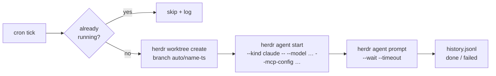

# herdr-automations

**Scheduled tasks for your coding agents.** A prompt, a cron line, and a fresh git worktree per run.

[](LICENSE)
[](go.mod)
[](https://herdr.dev)

```yaml
automations:
  - name: issue-triage
    cron: "0 9 * * 1-5"
    repo: ~/Projects/myapp
    model: sonnet
    prompt: |
      Triage new GitHub issues: label them, close duplicates,
      draft replies for the ones needing more info.
```


If you have used ChatGPT's Scheduled tasks, this is the same boundary — a prompt, a
schedule, a model, and a choice between an isolated worktree and the repo itself —
except it runs in your terminal, on your machine, against your repos, and the config
is one YAML file you can keep in git. Unlike agent schedulers that ship an account
and a webhook relay (Open Run, for one), nothing leaves the machine and nothing
installs outside the plugin.

Every weekday at 9:00, a Claude (or Codex, or opencode…) agent spawns in a fresh
worktree of `myapp`, gets that prompt, and works until it's done. You arrive to
triaged issues, a branch to review, and a run log.
[What it does to your machine](#what-this-does-to-your-machine) is stated outright.

## Why

[Herdr](https://herdr.dev) keeps your agents alive when you close the laptop — but
*you* still have to start them. Recurring chores — issue triage, nightly flake hunts,
a Friday digest — deserve better than you retyping the same prompt every morning.

## Highlights

- **Every run is a branch you can review** — `auto/<name>-<timestamp>` in a fresh worktree, so a run that went sideways is a diff you throw away, not a mess in your working copy. `workspace: root` when the task must see uncommitted state, `workspace: existing` when a run an hour would bury the sidebar
- **One YAML file** — no DSL, no store, no database. What the plugin knows is the file you wrote plus an append-only run log
- **Installs without a toolchain** — prebuilt, checksum-verified binaries for macOS and Linux (arm64/amd64)
- **`model:` per automation** — a nightly chore has no business on your most expensive model. Set it where you read it; a kind that takes no `--model` is caught when the file loads, not at 3am
- **Survives sleep** — occurrences are computed off the wall clock, so a run due while the laptop slept fires on wake (within `catch_up_minutes`) instead of vanishing; anything too late is recorded as `missed`
- **Schedules that overlap say so** — the wizard warns while you are still choosing the cron, and `list` reports every overlap in the week ahead. Herdr starts them all; the plugin never quietly holds one back, it just makes sure you knew
- **Overlap guard** — a tick that fires while *that same* automation is still working is skipped, never queued into a pile-up
- **Targets a bot** — `target: bot:<id>` hands the prompt to a bot's own terminal (starting it when it is not running, and re-reading it before the send), or `worker:<id>` starts a worker of that bot for the run and ends it once its turn finishes (a worker still mid-turn at the timeout stays, logged; ADR 0014). By id from the project's `bots.json`, never by a terminal address
- **Agent-agnostic** — anything `herdr agent start` supports: `claude`, `codex`, `opencode`, `gemini`, `cursor`, …
- **MCP attach** — `mcp_config: path.json` hands the agent its MCP servers (GitHub, Slack, your DB…)
- **Full run history** — append-only JSONL: `scheduled → running → done | failed | skipped | missed`, with workspace and pane IDs to jump back into
- **Self-updating daemon** — it re-executes itself when the plugin binary changes, and a file lock keeps a second scheduler from double-firing everything
- **Live board** — an overlay pane inside the Herdr TUI: next run, last status, `r` to run now, `enter` to jump straight into the workspace a run created
- **Agents can self-schedule** — a bundled [skill](skills/creating-automations/SKILL.md) teaches coding agents the format: say *"triage my errors every morning"* and the agent writes the entry itself
- **Herdr desktop app** — `backend: hc` runs automations in the [app](#desktop-app), with a panel beside Files and Changes: an inbox of finished runs, run now, pause, and a form with the next runs previewed
- **A failure finds you** — a run that fails, a run that's missed, or a broken entry raises a Herdr toast; everything else stays quiet

## What it isn't

**An automation is one piece of work on a clock.** Not a sequencer, not a workflow engine,
not a place to put branching logic. One prompt (or one plain command, with no
model at all), one schedule, one run.

**No store, no daemon to install, no state you can't read.** Two files: your
`automations.yaml`, and `history.jsonl`. Uninstalling leaves both behind.

**Nothing happens that the file doesn't say.** The scheduler doesn't queue, throttle,
stagger or clean up behind your back. Where that could surprise you — overlapping
schedules, accumulating worktrees — it reports and waits for you.

## Quick start

Herdr comes as a desktop app and as a terminal UI. Install for the one you use, the
[desktop app](#desktop-app) or the [terminal](#terminal-tui): both read the same
`automations.yaml`.

**Four ways to add an automation**, all writing the same file:

1. `herdr-automations add` — the wizard: validates the cron, previews the next three
   runs, and warns if another automation is already due at the same time

   

2. **The app's form** — `+` in the panel, with the next runs previewed as you type
3. **Edit the YAML** — `herdr plugin config-dir dnzzl.automations` → `automations.yaml`
   (or press `e` on the TUI's board to open it at the right line). Full reference in
   [`automations.example.yaml`](automations.example.yaml)
4. **Ask your agent** — see below

The daemon picks up edits within 30 seconds, no restart.

```bash
herdr-automations list             # schedule, model and last run per automation
herdr-automations run issue-triage # trigger now, don't wait for cron
herdr-automations history         # what ran, when, how it ended
herdr-automations cleanup         # drop the run worktrees whose work already landed
```

### Let your agent do the scheduling

The plugin ships a skill that teaches coding agents this file format. Install it
once with [`npx skills`](https://github.com/vercel-labs/skills), which links it
into every agent it finds (Claude Code, Codex, OpenCode, …):

```bash
npx skills add DnzzL/herdr-automations
```

Then, in any new agent session, plain language is enough:

> *"Every Monday at 9am, review the open PRs and tickets on myapp and propose a sprint."*

> *"Every weekday morning, triage the new errors and file the real ones as tickets."*

> *"Stop the flaky-hunt automation for now."*

The agent writes the YAML entry, and the daemon picks it up within 30 seconds. The
skill is a copy: after upgrading the plugin, run `npx skills update` to match.

## Desktop app

The [Herdr app](https://herdr.dev) runs its agents in herdr-core (`hc`), not in the
TUI's server, and the two share no agents. Set `backend: hc` and runs open as spaces
in the app instead, with a panel of their own beside Files and Changes (pictured at the top):

- **Inbox** — runs that finished since you last looked; a failure says why. Click one to
  jump into its terminal while it is still open. `Mark all read` clears it
- **Every automation** — schedule in words, next run, agent and model; its dot takes the
  app's working or blocked color while a run is live, and red when the last one failed.
  `▶` runs it now
- **Detail and form** — click an automation for its history, `Run now`, `Pause`, `Edit`,
  `Delete`. `+` opens the form: schedule presets or raw cron with the next three runs
  previewed as you type, a folder picker for the repo, the agent or an `hc` template
- **Pause everything** — the switch in the header holds every automation. What comes due
  meanwhile is logged as skipped and never replayed when you switch back

```yaml
backend: hc        # herdr (the default), hc, or auto: hc when herdr-core answers
automations:
  - name: issue-triage
    template: reviewer   # hc only: a template brings its own agent, model and instructions
    # …
```

A run in `worktree` mode checks out where the app's own **New worktree…** would
(`~/.herdr/worktrees/<repo>/<branch>`), so the app nests it under the repo's space when
one is open. Closing a run's space calls the run off, as in the TUI.

**Install without the TUI.** The app has no plugin startup hook, so the scheduler runs
as a login service (a launchd agent on macOS, a systemd user unit on Linux):

```bash
git clone https://github.com/DnzzL/herdr-automations && cd herdr-automations
sh scripts/install.sh                                    # prebuilt binary into bin/
ln -s "$PWD/bin/herdr-automations" ~/.local/bin/         # where the panel looks for it
herdr-automations service install                        # scheduler at login, now
cp -R app/mods/automations ~/.config/herdr-app/mods/     # the panel
```

The panel needs a slot in your layout: clone the shipped `main` layout and `tabs` mod
(`herdr-app do layout.clone --name main --as main-plus`, then `mod.clone` for `tabs`),
add an `automations` block to the `panel-body` stack, and a button for it in the tab bar.
Or ask your agent to add the mod from this repo: [`app/RECIPE.md`](app/RECIPE.md) is the
brief it builds from, as for any mod on [herdr.dev/mods](https://herdr.dev/mods).

With the TUI plugin installed too, `install-cli` ([below](#terminal-tui)) already puts the CLI where the
panel finds it; skip the `ln -s`. Without the TUI the shim has no Herdr to ask, hence
the link.

Under `backend: hc`, a run needs an agent that takes its prompt as an argument and
reports its state to herdr-core, or a finished run can't be told from a stuck one:
`claude`, `pi` and `copilot` (measured), `codex` (assumed, untested). `copilot` gets its
prompt through `-i`, and asks whether to trust a folder it has not seen: trust
`~/.herdr/worktrees` (and any `root` repo) once, or a run waits on that question until
it times out. The form offers the ones installed. Other kinds are refused when the file loads; the TUI, which reads agents'
screens itself, runs them all. `workflow:` and `session:`
belong to the TUI and are refused too. A daemon started by a TUI session still exits
with the last one under `backend: herdr`; the login service never does.

## Terminal (TUI)

### Install

```bash
herdr plugin install DnzzL/herdr-automations   # prebuilt binary, no toolchain needed
herdr plugin action invoke install-cli --plugin dnzzl.automations   # shim in ~/.local/bin
herdr-automations add                          # wizard: validates cron, previews next 3 runs
```

Prebuilt for macOS and Linux (arm64/amd64), checksum-verified at install; anything
else builds from source and needs Go.

Herdr doesn't put plugin binaries on `PATH`, so `install-cli` writes a small
`herdr-automations` shim that asks Herdr where the plugin lives on every call:
`herdr plugin update` keeps it working. The action runs in the background and
prints nothing; if `herdr-automations` is then not found, add `~/.local/bin` to
your `PATH`. To put the shim in another directory:

```bash
"$(herdr plugin list --plugin dnzzl.automations --json | sed -n 's/.*"plugin_root":"\([^"]*\)".*/\1/p')"/bin/herdr-automations install-cli ~/bin
```

### The board


A live overlay listing every automation with its next run and last status:

```bash
herdr plugin pane open --plugin dnzzl.automations --entrypoint board --placement overlay
```

| Key | Does |
|---|---|
| `enter` | **Jump to the last run** — focuses the workspace that automation spawned, so you land right in the agent's terminal |
| `r` | Run the selected automation now |
| `e` | Open `automations.yaml` in `$EDITOR`, **cursor on that automation's line** |
| `c` | Clean up the run worktrees whose work already landed — it counts them, asks `y/n`, and touches nothing else |
| `j` / `k` | Move · `q` closes |

Bind it to a chord so you never type that command again — in `~/.config/herdr/config.toml`:

```toml
[[keys.command]]
key = "prefix+a"
type = "shell"
command = "herdr plugin pane open --plugin dnzzl.automations --entrypoint board --placement overlay"
```

The plugin also registers an action (`herdr plugin action invoke run-now --plugin dnzzl.automations`)
that prompts for which automation to fire.

## How a run works



Everything goes through the `herdr` CLI — the same socket API agents themselves use. No private hooks, nothing to break on Herdr upgrades.

## Full entry reference

```yaml
backend: hc                       # optional: herdr (default) | hc (the desktop app) | auto
paused: true                      # optional: hold every automation (the panel's switch)
automations:
  - name: issue-triage            # unique, kebab-case
    cron: "0 9 * * 1-5"           # 5-field crontab, or @daily / @hourly / @weekly
    repo: ~/Projects/myapp
    workspace: worktree           # worktree (default) | root | existing
    session: automations          # optional Herdr session the run happens in
    agent: claude                 # any `herdr agent start --kind`
    model: sonnet                 # optional → --model; kinds without the flag are caught on load
    template: reviewer            # hc only, instead of agent + model: an hc template, prompt as its task
    prompt: "…"                   # OR workflow: <name>  (delegates to hwf run)
                                  # OR command: {argv, cwd, env} — see "Run a plain command"
    mcp_config: ~/.config/mcp/github.json   # optional MCP servers JSON file; see below
    agent_args: ["--verbose"]               # optional, verbatim agent flags
    timeout_minutes: 60           # optional bound on the run
    catch_up_minutes: 120         # how late a sleep-delayed run may still start; -1 never
    blocked_grace_minutes: 2      # fail at once on a dialog after this long; -1 waits the timeout
    close_workspace: on-success   # optional: close a done run's workspace (existing: its own tab)
    disabled: true                # optional: keep it, don't schedule it
```

`blocked_grace_minutes` applies to both agent backends: `0` or an omitted key
uses 2 minutes; `-1` waits until completion or the run timeout. A continuous
blocked state past the grace fails the run with the dialog line and a notice.
On hc the terminal is killed without removing its record. On herdr the scheduler
re-reads both the agent status and `pane process-info` before asking it to stop.
If the dialog cleared, it resumes the run without a blocked failure. It requests
SIGTERM only when the foreground group is unchanged and is not missing, the shell,
or the scheduler. The failure error and log say "asked the agent to stop (SIGTERM)";
exit is not confirmed and SIGTERM is not escalated, so a TERM-ignoring dialog can
survive. A refused or unsuccessful request is reported as such. These rechecks
narrow the read/signal window; a change after them can still race the signal.
Neither failure path asks to close the pane, tab, or workspace.

Herdr prompt retries check the run deadline and wait one status-poll interval
between submissions. If submission keeps reporting blocked but status never
shows it, three consecutive mismatches fail with a clear error; a shorter run
deadline wins. No signal is requested for this status mismatch.

`ls --json` reports the effective grace (2 when the key is absent). A form that
echoes that value back through `put` writes an explicit 2. A `put` that omits the
key preserves the file's value; sending `0` removes the key and uses the default.

A new automation written with `put` and no `agent_args` key starts on the same
automatic mode as one made in the panel's form: `--dangerously-bypass-approvals-and-sandbox`
for codex, `--dangerously-skip-permissions` for claude, nothing for any other agent,
a template or a workflow. Send the key to choose your own flags (`[]` for the
agent's own default). An edit (`--original`) never adds them.

For Copilot, `mcp_config` becomes `--additional-mcp-config @<path>`; the `@`
tells Copilot to read the file rather than parse its path as inline JSON.
Other agents still receive `--mcp-config <path>`.

### Run a plain command

A job that is one script needs no agent. `command:` instead of `prompt:` has
the scheduler start the program itself: no pane, no model, no workspace.

```yaml
automations:
  - name: daily-check
    cron: "0 7 * * *"
    command:
      argv: ["./check.sh", "--all"]   # the program first; no shell reads this
      cwd: ~/checks                   # optional working folder; your home folder otherwise
      env: { REGION: eu }             # optional, added to the scheduler's environment
    timeout_minutes: 10               # optional, default 60
    notify: b-xxxxxxxx                # optional: the bot told the result
```

- It runs as you, like a cron job: your network, your files. There is no
  sandbox; only the folder, the environment and the timeout are the automation's.
- Exit 0 is `done`. Any other exit, a signal, the timeout or a program that
  would not start is `failed`. `history --json` carries `exit_code`, `stderr`
  (its last ten lines) and `result`: the last line of stdout when it worked,
  else the failure.
- `argv` is not a shell line. For pipes, `&&` or redirects, put them in a
  script and run the script. A relative program (`./check.sh`) is found from
  `cwd`; a bare name is looked up in the scheduler's PATH, which under the
  login service is the one captured at `service install`.
- `notify:` sends the result line to a bot through herdr-core's `hc send`: the
  terminal labelled `bot=<id>`, else a terminal by that name. A bot that is
  blocked or not running gets nothing, and `history --json` says so in
  `notified`. The run's status never depends on it.
- A command entry takes no `repo`, `workspace`, `session`, `agent`, `model`,
  `template`, `agent_args`, `mcp_config`, `blocked_grace_minutes` or
  `close_workspace: on-success`: the loader refuses each by name.
- At the timeout the program and everything it started get SIGTERM, then
  SIGKILL ten seconds later if anything is left. A scheduler told to stop
  (SIGINT, SIGTERM, a service stop) ends its running commands the same way and
  records them `failed`.
- There is no way to stop one running command yet: it ends when it exits or at
  `timeout_minutes`, so give a command a timeout that fits it. A scheduler that
  is killed outright, or a `herdr-automations run` interrupted by hand, leaves
  its command running.

Why this exists, and what was turned down: [ADR 0013](docs/adr/0013-a-command-is-a-run-the-scheduler-does-itself.md).

### Run in a shared workspace

Create a workspace once with `herdr workspace create --label Automations --no-focus`,
or find an existing one with `herdr workspace list`. Use its returned ID:

```yaml
automations:
  - name: daily-summary
    cron: "@daily"
    repo: ~/Projects/myapp
    workspace: existing
    workspace_id: w7              # replace with your workspace's ID
    agent: claude
    prompt: "Summarize recent changes."
```

Point several automations at the same `workspace_id` to collect their runs in one
space. Each run opens a fresh tab labeled with its automation name and timestamp,
uses `repo` as its working directory, and leaves your focus unchanged. Earlier tabs
remain open for review; each run gets a distinct agent name. With
`close_workspace: on-success` a successful run asks to close only the tab it opened.
Closes in one scheduler process serialize per workspace and re-read its tabs under
the lock immediately before acting: it leaves the last tab it can see. It also
refuses when the list cannot be read or when the tab is no longer listed. A
person closing the space's other tabs in between can still leave it last, and the
app then takes the space with it. The lock is process-local: a manual `run` or a
second daemon does not share it and can race the same way.

Like `root`, this mode works directly in `repo` and creates no Git worktree. Runs
sharing a directory can see each other's file changes. `workspace_id` is required
only for `existing` mode and belongs to the automation's Herdr session. If
you close that workspace, runs fail until you update the ID; the plugin does not
create a replacement — see [ADR 0009](docs/adr/0009-a-run-may-share-a-workspace.md).
The `add` wizard also offers this mode.

### Run in a dedicated Herdr session

Keep cron runs out of the sessions you work in by naming one:

```yaml
automations:
  - name: issue-triage
    cron: "0 9 * * 1-5"
    repo: ~/Projects/myapp
    session: automations
    prompt: "Triage new GitHub issues."
```

Every run of that automation, from the cron, `r` on the board, or `run`, is
provisioned in `automations`. Without `session:`, a run lands where it is
triggered from: the board's or shell's session, or for the cron, the session
that started the daemon. The plugin never starts a session. Start it yourself
(`herdr --session automations server` runs it headless), and a run aimed at a
stopped one fails with Herdr's own error. `list` names the automations whose
session is not running.

One scheduler serves every session on the machine. It outlives the session that
started it and stops once no session is running. Failure toasts appear in every
running session, so a dedicated one cannot swallow them. `enter` on the board
jumps only within its own session. For a run elsewhere, it tells you which
session to attach — see [ADR 0010](docs/adr/0010-the-daemon-belongs-to-no-session.md).

## What this does to your machine

`herdr-automations` schedules and records. It never runs your prompt itself: it asks
Herdr to provision a workspace or tab and start an agent, and that agent runs under whatever
permissions Herdr gives it. So the honest statement is about the scheduler, and the
agent's own posture is Herdr's to describe.

- **Writes to two places** — the plugin config dir (`herdr plugin config-dir dnzzl.automations`) and `~/.local/state/herdr/plugins/dnzzl.automations` for the run log. Nothing else on disk is touched by the plugin itself
- **Creates git worktrees and branches** in the repos you name, `auto/<name>-<timestamp>`. It never removes one on its own — `herdr-automations cleanup` is the only thing that deletes, it asks first, and it only touches `auto/` branches already contained in your default branch
- **Opens no ports**, phones nothing home, and downloads nothing at runtime — the only network access is `herdr plugin install` fetching a checksum-verified release binary
- **Raises a Herdr toast** on a failed run, a missed run, or a broken `automations.yaml` entry — in every running Herdr session: a panel inside the Herdr window, not an OS notification, and not sent anywhere
- **`herdr plugin uninstall`** removes the plugin and leaves your config and history where they are
- **With the app** — `service install` writes one file, `~/Library/LaunchAgents/dev.dnzzl.herdr-automations.plist` (or `~/.config/systemd/user/herdr-automations.service`), with your `PATH` in it so the scheduler finds `hc`, `git` and the agents. It runs the `install-cli` shim when there is one, and relaunches itself within 30 seconds of a `herdr plugin update`. `service uninstall` removes it. Under `backend: hc` no Herdr toast exists for an outside process to raise, so failures are announced by the panel while a Herdr window is open

## FAQ

**Does my machine need to be awake?** For the run to start, yes — and laptops sleep.
So the scheduler works off the wall clock, not a timer: an occurrence that came due
while the machine was asleep **runs when it wakes**, as long as it's within
`catch_up_minutes` (default 2 hours). Anything older is recorded as `missed` in the
history rather than silently skipped, so `herdr-automations history` always tells you
what didn't happen. Set `catch_up_minutes: -1` for automations that are pointless late.

Timers alone don't survive sleep — macOS suspends the monotonic clock, so a job armed
for 9am Monday can simply never fire. Hence the wall-clock loop.

**Two automations due at the same minute — what runs?** Both. Herdr is a multi-agent
runtime and `0 9 * * 1` means 9:00, so the scheduler doesn't queue, throttle or
quietly stagger anything behind your back. What it does instead is tell you: the
wizard warns while you're still choosing the cron, and `herdr-automations list`
reports every overlap in the next week. If running them together isn't what you
want, move a cron — one character, and the file still says what happens.

**What happens to the tabs `workspace: existing` opens?** They accumulate by default,
and nothing reaps them: a tab you have read is a tab you close. `cleanup` has
nothing to say about them — there is no worktree and no branch, so the only trace a
run leaves is its line in `history.jsonl`. Set `close_workspace: on-success` to have
a successful run ask for its own tab; the scheduler issues no space close itself.
Closes in one scheduler process serialize per workspace and re-read under the lock:
it leaves the last tab it can see. It refuses when the space's tabs cannot be
read or when they no longer list it. A person closing the
space's other tabs in the same moment can still leave it last, and the app then
takes the space. A manual `run` or a second daemon has its own lock and can race
the same way; the mutex coordinates only closes in one scheduler process.

**What happens to the worktrees?** They accumulate on purpose: a run whose workspace
is still open is a run nobody has looked at, which makes the Herdr sidebar the inbox.
Closing it is how you say you're done.

For a chore whose successful runs need no reading, `close_workspace: on-success`
closes the workspace once the run is recorded `done`, or with `workspace: existing`
only the tab that run opened. Failed, cancelled and timed-out runs stay open, and a
run whose agent waits on a person is not closed. The worktree stays on disk for
`cleanup` ([ADR 0012](docs/adr/0012-a-successful-run-may-close-its-workspace.md)).

`herdr-automations cleanup` removes only the ones whose work already landed — the
branch is an ancestor of the default branch, so either it was merged or the agent
produced no commit at all. Anything with a workspace still open, or commits that
exist nowhere else, is kept and told why. It prints its verdicts, asks once, and
neither the worktree nor the branch is removed by force: git refuses a dirty
checkout and refuses an unmerged branch, and those refusals are worth more than
the tidiness. **It never runs on a schedule** — a reaper would delete the very
signal that says which runs still want you.

**What about multi-step chores?** An automation is one piece of work on a clock. If your
chore is a sequence, put the sequence in a
[herdr-workflows](https://github.com/aorumbayev/herdr-workflows) workflow and
schedule it with `workflow: <name>` instead of `prompt:`. The run waits for the
workflow and fails when it does, and it refuses to start at all when `hwf` isn't
installed.

**Event triggers? On push, on PR?** No, and not planned. Herdr's plugin manifest does
support `[[events]]`, but the full list, as of Herdr 0.8.2, is workspace lifecycle and
nothing else: `worktree.created`, `worktree.removed`, `workspace.created`,
`workspace.closed`, `workspace.focused`, `workspace.renamed`, `workspace.updated`,
`pane.created`, `pane.closed`, `pane.exited`, `pane.focused`, `pane.updated`,
`tab.created`, `tab.closed`, `tab.focused`, `tab.renamed`, `layout.updated`. There is
no git event, no push, no pull request, and no webhook endpoint. Turning a GitHub push
into a local run means something hosted in the middle holding your repo names and
listening for the hook, which is the opposite of the two paragraphs above. If you want
work to happen on push, your forge's CI is already there. If you want it locally, a
cron automation that polls and does nothing when there is nothing new (`gh pr list`,
`git fetch`) is one entry in this file. See [ADR 0008](docs/adr/0008-no-event-triggers.md)
for the full reasoning.

An automation is one piece of work on a clock: a prompt, or a plain command. That is the whole boundary.

## Development

```bash
go build -o bin/herdr-automations . && go test ./...
herdr plugin link .        # use your checkout as the installed plugin
AUTOMAGIK_HERDR_APP_CHECK=1 go test -tags hc ./internal/host/ -run Live   # against the real herdr-core, Herdr app open
scripts/dev-app.sh         # copy the panel into the app (a symlink is not reloaded)
```

Design decisions live in [`docs/adr/`](docs/adr/); the app backend is
[ADR 0011](docs/adr/0011-the-app-backend.md).

## Known gaps

- **Overlap guard is per process** — `▶` in the panel starts a separate process, which
  does not see a scheduled run of the same automation already working, so both can run
- **Resuming one paused automation** may record the occurrences it skipped as `missed`;
  the global pause does not
- **Space adoption while the app is closed** is untested: a run started then should
  appear on next open
- **Agents under hc** are limited to those that report their state to herdr-core;
  OpenCode does not yet. `codex` is allowed but untested
- **`close_workspace`** is tested against fakes; the Herdr and hc calls it makes were
  measured by hand, not yet through a full scheduled run. Not settable from the panel
- **The panel finds the CLI** on `PATH`, else `~/.local/bin`; installed anywhere else, it
  shows an error
- **Installing the panel means cloning `main` and `tabs`** until Herdr makes panel buttons
  data-driven; [`app/RECIPE.md`](app/RECIPE.md) walks an agent through it

PRs welcome — especially agent kinds tested in the wild, cleanup policies, and notification shapes.

## License

[MIT](LICENSE)
